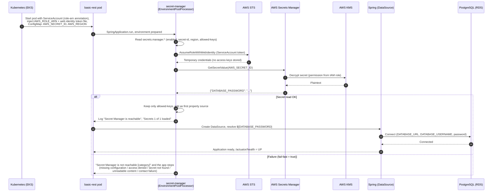
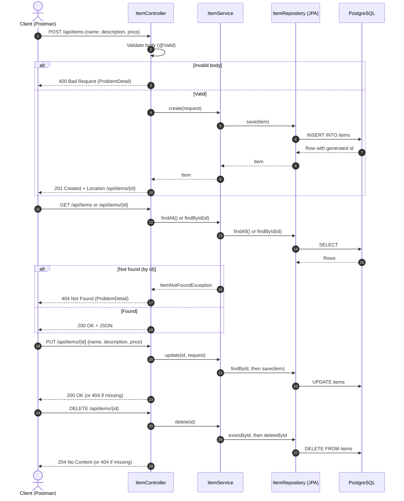
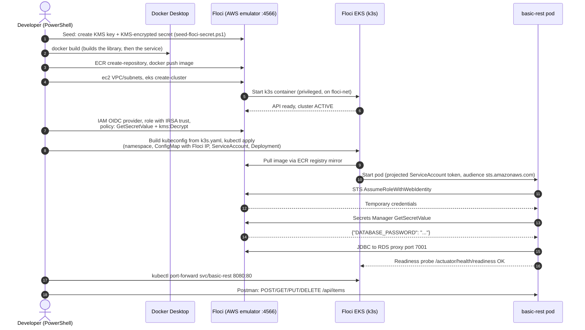

# basic-rest: sequence diagrams

Three flows: (1) pod startup with the password loaded from AWS Secrets Manager via IRSA, (2) a CRUD request, (3) the local Floci EKS deployment.

## 1. Startup: loading `DATABASE_PASSWORD` (IRSA + Secrets Manager + KMS)

The ConfigMap holds only `AWS_SECRET_ID` and `AWS_REGION`. The password is never in Kubernetes.

## 2. CRUD request

## 3. Local deployment on the Floci EKS cluster

`scripts/deploy-floci-eks.ps1`, run after `docker compose up -d`, the RDS instance creation and `scripts/seed-floci-secret.ps1`.

